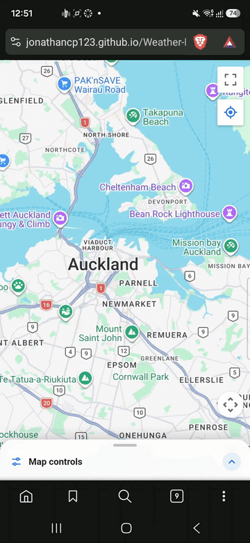
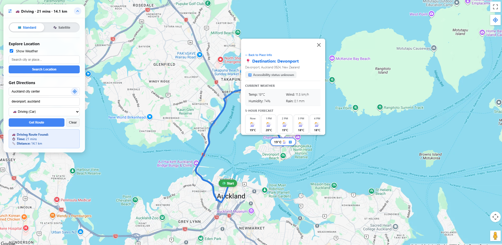

# Wayther

**Weather, routes and wheelchair accessibility on one map.**

Wayther is a mobile-first web app built with React, TypeScript and the Google Maps JavaScript API. Tap any place to see its live weather, a 5-hour forecast and whether it has a wheelchair-accessible entrance, or plan a route and check the weather at your destination before you leave.

**Live demo:** [jonathancp123.github.io/Weather-Map-App](https://jonathancp123.github.io/Weather-Map-App/)

<p align="center">
  
</p>



---

## Features

- **Weather anywhere:** tap a shop, park or landmark on the map to drop a pin showing the current temperature. The card shows the address, accessibility info, current conditions (temperature, wind, humidity, rain) and a 5-hour forecast.
- **Wheelchair accessibility:** each place card shows whether Google lists an accessible entrance.
- **Route planning:** get driving or public-transport directions with travel time and distance. A weather pin appears at the destination. While a route is shown, you can keep exploring other places without losing the route.
- **Locate me:** centre the map on your position, or use it as the route's starting point. On first load the map opens near you without asking for permission (see [Privacy](#privacy)).
- **City search:** jump to any city or town.
- **Weather on/off:** switch weather off to use the map for places and routes only; no weather requests are made while it's off.
- **Built for phones:** the controls fold into a bottom sheet, cards resize as you zoom (full, compact, then hidden when zoomed far out) and always fit the screen.
- **Standard / satellite** map toggle.

## Tech stack

| Area | Tools |
|---|---|
| Frontend | React 18, TypeScript, CSS |
| Build | Vite |
| Maps | Google Maps JavaScript API (Maps, Advanced Markers, Places, Geocoding, Directions) |
| Weather | [Open-Meteo](https://open-meteo.com/) forecast and geocoding APIs (free, no key) |
| Rough location | [ipwho.is](https://ipwho.is/) |
| Hosting | GitHub Pages via `gh-pages` |

---

## How it works

### Project structure

```
src/
  App.tsx                 app state, map setup and event handlers
  types.ts                shared types (PlaceInfo, RouteSummary, ...)
  constants.ts            default centre, zoom levels, phone breakpoint
  utils.ts                escapeHtml, withTimeout
  cards.ts                HTML for the place/weather cards and pin labels; zoom-based card sizes
  services/
    weather.ts            Open-Meteo forecast + city search, weather-code-to-icon mapping
    location.ts           browser geolocation, IP-based rough location with a 12-hour cache
    places.ts             Google place details and reverse-geocoding
    directions.ts         readable messages for route errors
  components/
    ControlsPanel.tsx     collapsible panel (bottom sheet on phones)
    MapTypeToggle.tsx     standard / satellite switch
    SearchSection.tsx     weather toggle and city search
    DirectionsSection.tsx origin, destination, travel mode and route result
    LocateIcon.tsx        crosshair icon
  styles.css
```

API calls and pure helper functions live in `services/` and `utils.ts`, separate from React, so they can be read and tested on their own.

### Design decisions

- **No stale results.** If you tap a second place before the first one's weather has loaded, the old response must not overwrite the new pin. Each pin slot has a "generation" counter that changes whenever its pin is replaced; every async step (place lookup, weather fetch, reverse geocode) checks it after each `await` and discards outdated results. Outdated weather requests are also cancelled with an `AbortController`.
- **Routes keep their pins.** While a route is shown, the destination pin is kept in its own slot and tapped places go into a separate "explore" slot, so exploring never removes the route's pins. Search or locate-me start fresh and clear the route.
- **Opening near the user, without a permission prompt.** The starting position comes from the first available of: precise location (only if permission was already granted), a cached rough location, a rough IP-based location, and finally Auckland. This runs while Google Maps loads, so it adds no waiting time.
- **Zoom-aware cards.** Google's InfoWindow has no "is it open?" query, so the app wraps `open`/`close` to track it. Cards shrink when zoomed out, hide when zoomed far out, and come back when you zoom in, unless you closed them yourself.
- **Safe HTML.** Place names and addresses come from external APIs and are escaped before being inserted into card HTML.

---

## Running it locally

### Prerequisites

- [Node.js](https://nodejs.org/) 18 or newer
- A Google Cloud project with billing enabled and these APIs turned on:
  - Maps JavaScript API
  - Places API (New)
  - Geocoding API
  - Directions API

### Setup

1. Clone the repository and install dependencies:
   ```bash
   git clone https://github.com/jonathancp123/Weather-Map-App.git
   cd Weather-Map-App
   npm install
   ```
2. Create your environment file from the template and add your Google Maps API key:
   ```bash
   cp .env.example .env
   ```
   ```
   VITE_GOOGLE_MAPS_API_KEY=your_api_key_here
   ```
3. In Google Cloud, restrict the key to **websites** and add `http://localhost:5173/*` (key restrictions need the exact port).
4. Start the dev server:
   ```bash
   npm run dev
   ```
   Then open [http://localhost:5173/Weather-Map-App/](http://localhost:5173/Weather-Map-App/) (note the path).

> If the map shows `RefererNotAllowedMapError` on port 5174, another dev server is already using 5173. Stop it and start again.

### Scripts

| Command | What it does |
|---|---|
| `npm run dev` | Start the development server |
| `npm run build` | Type-check with `tsc`, then build to `dist/` |
| `npm run preview` | Serve the production build locally |
| `npm run deploy` | Build and publish `dist/` to the `gh-pages` branch |

### Deploying your own copy

`vite.config.ts` sets `base: '/Weather-Map-App/'` to match the GitHub Pages URL. If your repository has a different name, change `base` to match, and add your Pages URL (for example `https://<username>.github.io/*`) to the API key's website restrictions. `npm run deploy` builds with the key from your local `.env`.

A Google Maps browser key is always visible in the built JavaScript. That is expected; it is protected by the website and API restrictions, not by being secret.

---

## Privacy

- To open the map near you, the app sends a request to **ipwho.is**, which sees your IP address and returns an approximate (city-level) location. The result is cached in your browser for 12 hours.
- Your precise location is only requested when you press a "locate me" button, and only used in your browser and in the requests to Google and Open-Meteo for that spot.
- The app has no backend and stores nothing about you on a server.

## Roadmap

- Move routing to Google's newer Routes API
- Place autocomplete for search and route fields
- Walking and cycling directions
- Accessibility improvements (keyboard support, focus styles, screen-reader labels)
- Render cards as React components and add unit tests

## Credits

- Weather data by [Open-Meteo.com](https://open-meteo.com/), licensed under [CC BY 4.0](https://creativecommons.org/licenses/by/4.0/)
- Maps, places and directions by [Google Maps Platform](https://developers.google.com/maps)
- Approximate location by [ipwho.is](https://ipwho.is/)

## Licence

[MIT](LICENSE)

## Author

**Jonathan Pandiana**

- GitHub: [@jonathancp123](https://github.com/jonathancp123)
- LinkedIn: [linkedin.com/in/jonathan-pandiana-8058382b4](https://www.linkedin.com/in/jonathan-pandiana-8058382b4)
